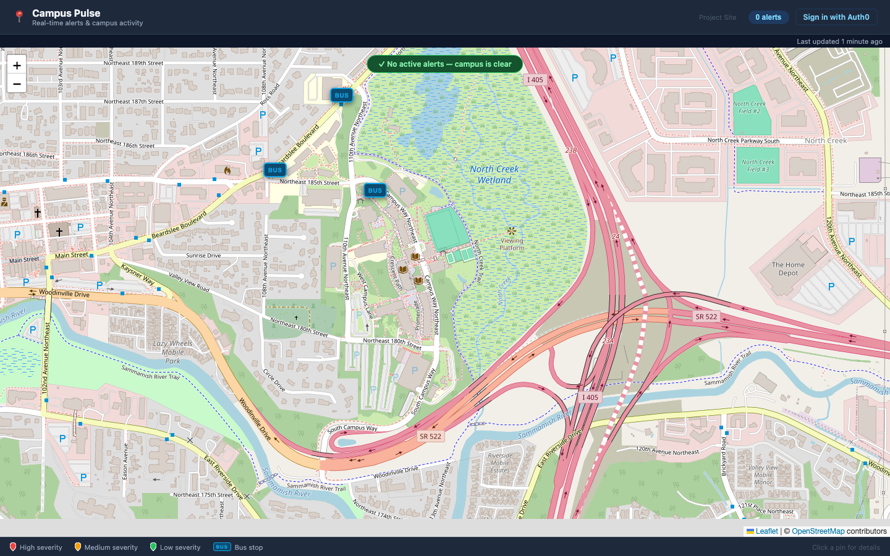

# Campus Pulse

A real-time campus map: official emergency alerts turned into map pins by an LLM, a personalized feed of campus events, and live bus arrivals.

## What it does

- **Alerts:** polls the official UW Alert feed, uses GPT-4o-mini to extract building, severity and scope, and pins campus incidents on the map. Public, no login.
- **For You:** ranks upcoming campus events for a signed-in UW student (Google sign-in through UW NetID + Duo) and explains each pick, e.g. *"Because you liked Technology events"*.
- **Buses:** next arrivals at the stops near campus, from OneBusAway.

## Architecture

The detailed diagram, with one request traced step by step, is in [ENGINEERING.md](ENGINEERING.md#architecture).

Background loops refresh alerts (5 min) and events (60 min) into memory, so API requests never wait on a feed or the LLM.

## Highlights

- **The backend verifies every sign-in itself.** It used to accept any user ID sent by the browser. Now FastAPI checks an Auth0 RS256 JWT against the tenant's public keys and enforces UW-only access server-side. Admin features need an RBAC permission in the token. Production probes return 401 for a missing, forged, or old-style request.
- **The LLM is measured, not trusted.** A labeled set of 34 alerts weighs errors by real-world harm (an under-called emergency is critical). Prompt iterations raised severity accuracy from 88% to 97–100% with zero under-calls. When prompt tweaks kept trading one mis-placed pin for another, a controlled run rejected my hypothesis, and a deterministic guard now refuses to pin an alert unless the text itself shows it's on this campus.
- **Silent failures, found and fixed.** The alert feed URL pointed at an always-empty comments feed while reporting "healthy", and a date regex dropped 408 of 411 events. Structured fields and fixture tests from the real feeds took events from **3 to 406**.
- **A recommender that can actually learn.** SVD on click-only data ranked about as well as random (measured), so I replaced it with an explainable hybrid score (category affinity, other dates of an opened series, item-item co-clicks, popularity, soonness) plus an offline leave-last-out evaluation against a popularity baseline.

More detail, with evidence for each change: [ENGINEERING.md](ENGINEERING.md).
